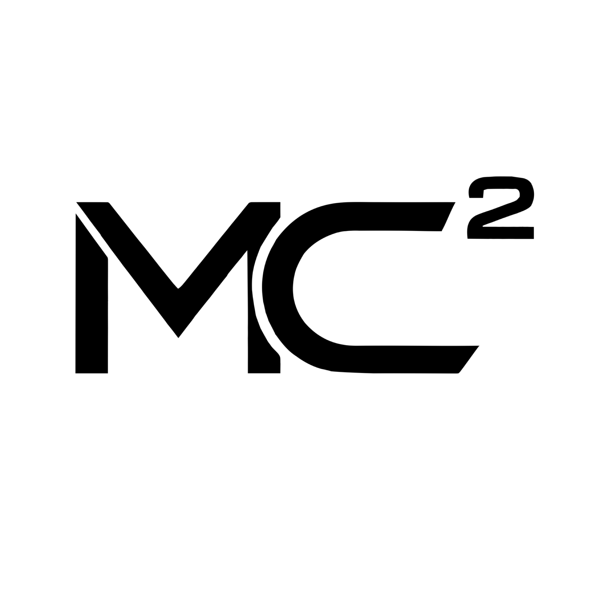

# MentorIA MC2 — product information

Version: 0.1.6 (Gemini skill export).

MC2 mentoring and services: [mikelmc2.com](https://mikelmc2.com).

Developed by **Grimory.ai**. Powered by Grimory.

This package contains the investigation and decision workflows used in the
MentorIA MC2 plugin, adapted as one skill for Gemini Apps. It does not include
an MCP server, Grimory login or external business storage. Platform account
and data policies still apply. The image and this attribution are supplied
reference material, not a promise that Gemini displays plugin-style logo,
developer or website fields in its interface.
